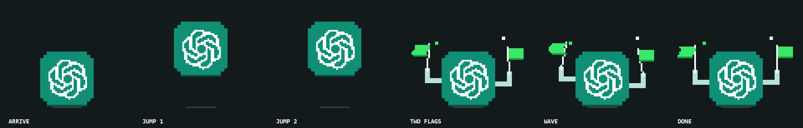

# chatgpt-done-pixel

Codex işini bitirdiğinde, saate bakarken bile fark edebileceğin küçük bir kutlama.

Piksel ChatGPT logosu ekranın **sağ altında, saat ve tarihin üstünde** belirir.
İki kez zıplar; sonra iki piksel kol açılır, iki yeşil bayrak iki kez sallanır
ve logo sağdan çıkar. Yaklaşık **5,7 saniye**, sessiz.



- Windows 10/11; PowerShell 5.1 ve .NET/WinForms, ek paket gerektirmez.
- Şeffaf, tıklamaları geçiren pencere; klavye odağını almaz, görev çubuğuna girmez.
- Ana ekranın kullanılabilir alanına yerleşir; görev çubuğunu kapatmaz.
- Aynı anda yalnızca bir animasyon çalışır.
- Codex'in `agent-turn-complete` bildirimiyle çalışır. Normal ChatGPT web
  sohbetlerini veya diğer uygulamaların bitişini izlemez.
- Mevcut `notify` komutunu koruyarak aynı JSON olayını ona da iletir.
- Ağ isteği yapmaz, sohbet metnini kaydetmez, API anahtarı istemez.

## Windows kurulumu

```powershell
git clone https://github.com/SametDuhan/chatgpt-done-pixel
cd chatgpt-done-pixel
powershell -NoProfile -ExecutionPolicy Bypass -File install.ps1
```

Kurulum `%USERPROFILE%\.chatgpt-done` içine çizim/bildirim betiklerini kopyalar;
Codex kullanıcı `config.toml` dosyasındaki `notify` komutunu bağlar. `CODEX_HOME`
tanımlıysa orası, değilse `%USERPROFILE%\.codex` kullanılır. Değişiklikten önce
tarihli bir config yedeği alınır; eski komut kurulum klasöründe tutulur.

**Codex/ChatGPT masaüstü uygulamasını veya Codex CLI'ı bir kez yeniden aç.**
Yeni `notify` ayarı çalışan oturuma geriye dönük yüklenmez. Sonraki tamamlanan
yanıtlarda animasyon görünür; izin sorularında veya araç çağrılarında görünmez.

Anında önizleme:

```powershell
powershell -NoProfile -STA -ExecutionPolicy Bypass -File "$env:USERPROFILE\.chatgpt-done\chatgpt-done.ps1"
```

Boyut/hız: `install.ps1 -Scale 5 -Speed 1.2`. Varsayılan piksel boyutu 4, hız 1;
ekran DPI değeriyle ölçeklenir. Büyük ölçek küçük ekranda kenarlara taşabilir.
Kurulumu tekrar çalıştırmak güvenlidir. Kurulumdan sonra `notify` başka bir
program tarafından değiştirilmişse tekrar kurulum/kaldırma bunu ezmeden durur.

## Codex WSL içinde çalışıyorsa

Python 3.11+ ve WSL'nin Windows uygulamalarını çalıştırabilmesi gerekir. Repoyu
Windows tarafında tut; böylece PowerShell çizim betiğine erişebilir.

```bash
cd /mnt/c/Users/<kullanici>/Desktop/chatgpt-done-pixel
python3 install-wsl.py
```

Bu, WSL kullanıcı config dosyasına bağlanır; Windows config'ini değiştirmez.
Adapter `~/.local/share/chatgpt-done-pixel` içine kopyalanır. Çizim betiği de bu kalıcı klasöre kopyalanır; Windows betiğe WSL UNC yolu
üzerinden erişir. Repoyu taşımak veya silmek bildirimleri bozmaz. Eski kurulumu
onarmak için yeni repo klasöründen `python3 install-wsl.py` komutunu tekrar çalıştır.
Windows ve WSL kurulumları ayrı ayrı yapılabilir; her biri kendi eski komutunu
korur. SDS/Claude ajanlarının çalışması bu bildirimi tetiklemez.

## Kaldırma

Windows:

```powershell
powershell -NoProfile -ExecutionPolicy Bypass -File uninstall.ps1
```

WSL:

```bash
python3 install-wsl.py --uninstall
```

Eski `notify` satırı geri yüklenir; diğer config ayarlarına ve sonradan eklenen
değişikliklere dokunulmaz. Uygulamayı yeniden aç. Config yedekleri yerinde kalır.
Kurucu yalnız tek satırlı, üst düzey `notify` dizilerini destekler. Windows'ta
dizi çift tırnaklı olmalıdır. Desteklenmeyen TOML biçiminde dosyaya yazmadan durur.

## Geliştirme ve doğrulama

```powershell
powershell -NoProfile -ExecutionPolicy Bypass -File tests\test_windows.ps1
powershell -NoProfile -ExecutionPolicy Bypass -File chatgpt-done.ps1 -RenderPreview docs\preview.png
```

```bash
python3 -m unittest discover -s tests -v
```

Windows testi geçici config üzerinde tekrar kurulum, kaldırma, eski komutun
korunması, sonraki config değişikliklerinin saklanması ve pencere konumunu
doğrular. WSL testleri aynı senaryoları ve yalnız tamamlanma olayının animasyon
başlatmasını doğrular. Gerçek model çağrısı gerekmez.

## Referans ve lisans

Referans: [SametDuhan/claude-done-pixel](https://github.com/SametDuhan/claude-done-pixel).
WinForms yaklaşımı bu MIT lisanslı projeden uyarlanmıştır; logo, iki kol/bayrak
ve Codex bağlayıcısı bu sürüm için hazırlanmıştır. Kod: [MIT](LICENSE).

Resmî bildirim mekanizması:
[OpenAI notification documentation](https://learn.chatgpt.com/docs/config-file/config-advanced#notifications).
Logo kaynağı: [assets/SOURCE.md](assets/SOURCE.md).
Bu proje OpenAI tarafından üretilmemiştir ve OpenAI ile bağlantılı değildir.
ChatGPT ve düğüm logosu OpenAI markalarıdır; kodun MIT lisansı markaları kapsamaz.
